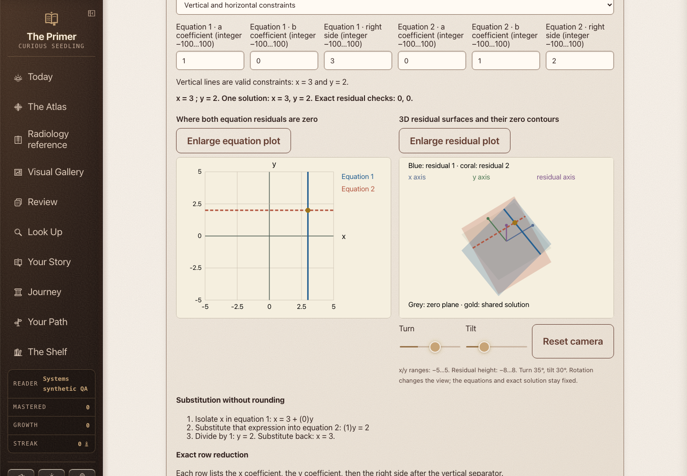
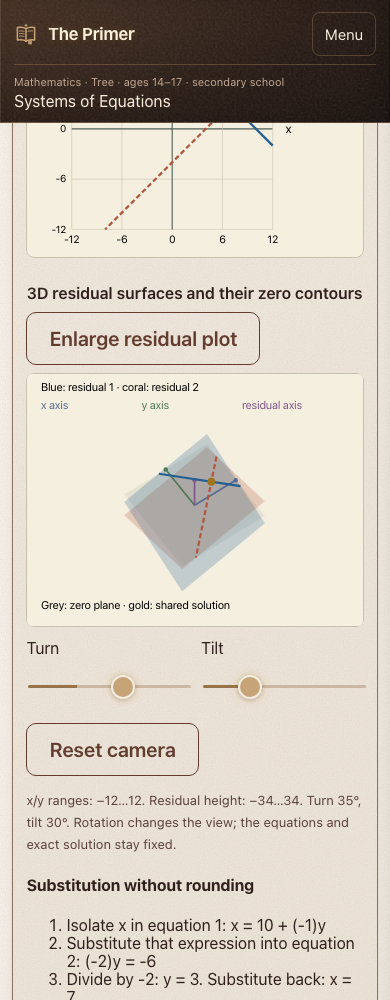

# Systems of Equations fidelity candidate

This companion uses general-form constraints `a₁x + b₁y = c₁` and `a₂x + b₂y = c₂`, including vertical lines and zero-coefficient rows. It preserves all ten original quiz objects and provides a preset for each question. Four additional examples expose vertical constraints, contradictory constants, one free line and the full solution plane.

Exact rational arithmetic drives independently checked substitution, row operations, ranks and residual checks. The 2D graph shows each equation's zero set. The rotatable 3D view plots the actual affine residual surfaces and their zero contours, with explicit separate axis scales; only a common point on the zero plane solves both equations. Enlarging either plot retains the equations and offers native scrolling for labels.

Validation: 5 numerical tests cover 15,625 small integer systems, 21 boundary systems, all 14 presets, invalid inputs and original-quiz preservation. The actual reader passed 28 preset/width rows at 1440 and 390 pixels, 140 camera actions, coefficient commits, invalid-input retention, enlargement/fit and two complete speech runs. The final integration selection passed 31,034 checks. All task-owned browser/server processes are closed.

The fixed five-file correspondence reconstructs the preceding main commit byte for byte so historical reviews retain their original scope. Renderer enrollment is restricted to this node/scenario; the earlier 70/28/cohort checks still run.

Release status: local candidate. Full PR CI and staging/production verification are the next gates. The broader radiology, math and physics objective remains incomplete.

