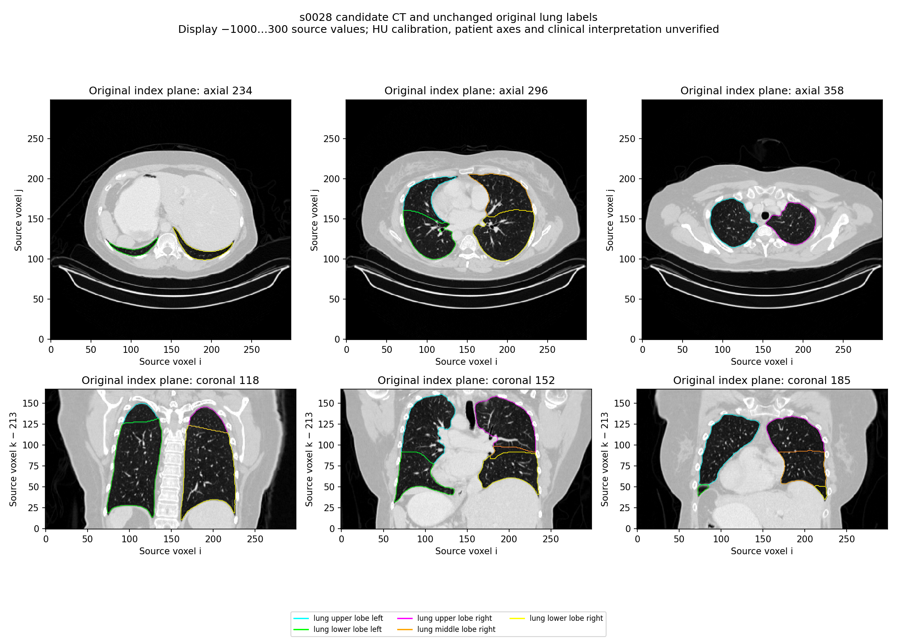

# Same-case lung CT and label-interface candidate: s0028

This review preserves the original CT, all five original lung-lobe masks and their derived 0.5 label interfaces from TotalSegmentator v3 case s0028. The source metadata describes a 59-year-old female, neck/chest/abdomen/pelvis CT and `no_pathology`; this is a publisher metadata label, not independent clinical approval.

The case was selected after screening s0028, s0364 and s0365—the first three eligible adult chest/thorax records, in identifier order, with `no_pathology` and reported slice thickness at most 1.5 mm. All five s0028 masks have one six-connected component, do not touch the scan boundary and have zero pairwise voxel overlap. These are geometric screening results, not proof that every anatomical boundary is correct.

All original CT/mask samples and affine matrices match two independent NIfTI readers. The retained grid is 299 × 299 × 394 with source-declared 1.5 mm pitch. Raw DICOM calibration, patient orientation and clinical normality remain unverified. All 351,784 derived triangles are retained without smoothing, padding, capping, fitting, relabeling or component deletion. The surfaces are derived label interfaces, not independently acquired pleural membranes or histological wall layers.

Six deterministic source-index planes were inspected against the CT. Further whole-volume and fissural-boundary review is required before integration. The source does not fill the missing pleural/pericardial tissue, airway-tree, diaphragm or other reporting obligations. No anatomical coverage or clinical approval is granted, and this candidate is not deployed.



The existing s0358 case remains unchanged. Its unequal labelled volumes and disconnected label regions are reasons to preserve case-specific context, not a diagnosis or permission to delete source components.

`source-review.json` records independent reader checks, original file hashes, original mask counts and derived surface hashes. `CT-acquisition.json` and `mask-screen-summary.json` retain exact-range/member-CRC evidence and the before/after publisher archive identity. The complete 37.4 GB archive MD5 has not been independently verified.

Reproduce with:

```sh
python tools/anatomy_sources/package_thoracic_lung_candidate.py \
  --source-root .research/thoracic-ct-correspondence-20261013/s0028 \
  --output docs/thoracic-lung-source-review-s0028
python -m pytest tests/test_thoracic_lung_candidate.py -q
```

Source and image/geometry adaptation: Jakob Wasserthal, [TotalSegmentator dataset v3.0.0](https://zenodo.org/records/22688904), DOI 10.5281/zenodo.22688904, [CC BY 4.0](https://creativecommons.org/licenses/by/4.0/). Source pixels are unchanged; the figure applies a documented display window and overlays original label contours. The dataset includes varied clinical conditions and does not supply a normality guarantee for this use.
