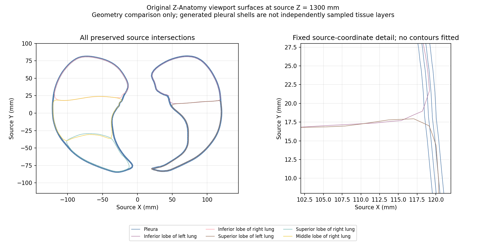

# Thoracic Z-Anatomy candidate review

**Decision: hold for anatomical correspondence review.** This package preserves nine source exports—pleura, five lung lobes and three caval segments—and records why their names and geometry alone cannot establish complete reporting anatomy. No source is promoted into the live module and no anatomical coverage is granted.

The source is the original Z-Anatomy scene at commit `ded1a55381328f3f242426f0e8e711c5fca62c14`, SHA-256 `9f08a17ea0115fed80b2a73ecdf0a1bc2ab2f6956f37c593ce23d513ea35afcd`. Blender 4.2.23 read it with file scripts disabled. The file remained byte-identical. Original control geometry and selected curve properties are stored separately from evaluated viewport tessellation. The export is not a complete serialization of every Blender property; the original pinned scene remains authoritative. Render-level subdivision and authored shading normals have not been independently reproduced here.

The pleural object has eight closed evaluated surface components. Its source uses subdivision and two Solidify modifiers, including author-defined layer separation and thickness. These are generated boundaries, not eight independently sampled tissue layers. Component order must not be relabelled as anatomical leaflet identity without source lineage and anatomical review. At the reviewed source plane, the pleural contours follow the outer envelope while lobe boundaries extend internally; complete fissural correspondence remains unverified. Fissural anatomy and variability matter to this assessment, as discussed in the original [thin-section CT study](https://dirjournal.org/articles/volumetric-thin-section-ct-evaluation-of-pulmonaryinterlobar-fissures/doi/dir.2015.15080).

The source-named left lower lobe extends about 1.28 source mm below the total pleural bounding box. This is a geometric source-coordinate discrepancy, not a patient measurement or a clinical diagnosis. No fitting, translation or surface extension conceals it.

All three evaluated caval segments have 24 boundary edges. Their geometry is curve-derived; independently acquired wall layers, endpoint anatomy and atrial junction correspondence are unverified. Every evaluated lung lobe also has open boundaries, and the right lower lobe has eight exact-position nonmanifold edges. Openings are not automatically defects: they need anatomical classification. No cap, smoothing or repair is applied.

`geometry-audit.json` records source-coordinate topology and bounds; matching identical positions is diagnostic only. `source-sections-z1300.png` shows linear triangle-plane intersections, without invented contours or source registration. Source axes and metric units follow the scene; acquisition calibration and patient orientation remain unverified.

The existing 12-object BodyParts3D module remains a separate curated source. These Z-Anatomy exports must not be fitted into that coordinate frame or counted as missing anatomy merely because a name matches.

Source and derivative data: [Z-Anatomy](https://github.com/Z-Anatomy/Models-of-human-anatomy), [CC BY-SA 4.0](https://creativecommons.org/licenses/by-sa/4.0/). The complete supplied license is retained byte-for-byte in `License.txt.gz`. This review changes neither clinical approval nor the whole-Primer fidelity objective.

Reproduce from the repository root with `python tools/anatomy_sources/audit_zanatomy_thorax.py` and `python tools/anatomy_sources/render_zanatomy_thorax_review.py` (NumPy and Matplotlib required). Run `python -m pytest tests/test_zanatomy_thoracic_candidate.py -q` to verify preserved bytes, source-coordinate topology and the explicit coverage hold.
